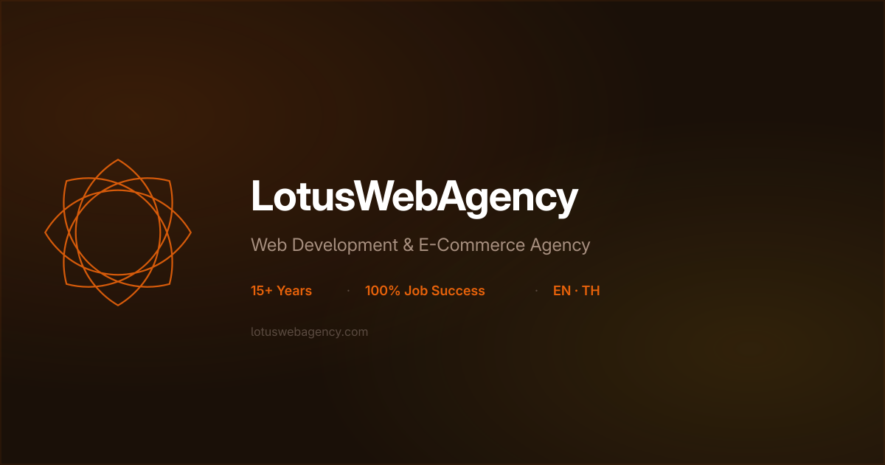

  

# Senior e-commerce and web engineering, from build to long-term operation

Lotus Web Agency builds, modernizes, and operates e-commerce stores, custom web
platforms, and the infrastructure behind them. We work as long-term technical
partners: direct access to senior specialists, practical decisions, and ongoing
responsibility after launch.

[Visit our website](https://lotuswebagency.com/?utm_source=github&utm_medium=referral&utm_campaign=organization_profile) ·
[See selected work](https://lotuswebagency.com/projects/?utm_source=github&utm_medium=referral&utm_campaign=organization_profile) ·
[Explore our services](https://lotuswebagency.com/services/?utm_source=github&utm_medium=referral&utm_campaign=organization_profile) ·
[Talk to us](https://lotuswebagency.com/contacts/?utm_source=github&utm_medium=referral&utm_campaign=organization_profile)

## We take responsibility beyond launch

- **E-commerce engineering:** storefronts, custom modules, payments, shipping,
  search, promotions, and the integrations that keep a store running.
- **Custom web platforms:** focused applications and APIs that replace legacy
  systems or off-the-shelf software a business has outgrown.
- **Performance and reliability:** Core Web Vitals, technical SEO implementation,
  migrations, deployment pipelines, monitoring, and resilient infrastructure.
- **Long-term support:** ongoing development and operation by the people who
  understand the product and its business context.

## Selected work

### [Hushscript](https://hushscript.com/)

Our private, browser-based transcription product. We designed, built, and
operate the public site, Vue application, Rust/WebAssembly backend, billing,
media-processing workflow, and Cloudflare infrastructure.

[Read the Hushscript case study](https://lotuswebagency.com/projects/hushscript/?utm_source=github&utm_medium=referral&utm_campaign=organization_profile&utm_content=hushscript)

### [Citimarine Store](https://citimarinestore.com/)

A long-term PrestaShop partnership covering the storefront, 39 custom modules,
Meilisearch, payment and shipping integrations, image delivery, deployment,
monitoring, and multi-region infrastructure.

[Read the Citimarine case study](https://lotuswebagency.com/projects/citimarine/?utm_source=github&utm_medium=referral&utm_campaign=organization_profile&utm_content=citimarine)

### [Capital Business Solutions](https://capitalbbw.com/)

A legacy WordPress website rebuilt as a custom Laravel and Filament platform
for listings, brokers, content, and lead management, followed by ongoing
development and support.

[Read the Capital Business Solutions case study](https://lotuswebagency.com/projects/capital-business-solutions/?utm_source=github&utm_medium=referral&utm_campaign=organization_profile&utm_content=capital_business_solutions)

## Technologies we work with

`PrestaShop` · `Laravel` · `Filament` · `PHP` · `TypeScript` · `Vue` · `Nuxt` · `Astro` ·
`Rust` · `WebAssembly` · `Cloudflare` · `Docker` · `Meilisearch` · `Redis` ·
`MySQL`

## A small team with a long view

- 15+ years of industry experience
- 5+ years working as a team
- 100% Job Success on [Upwork](https://www.upwork.com/agencies/lotuswebagency/)
- English and Thai communication
- A distributed team across Asia, working with businesses worldwide

We take on a limited number of partnerships so the people making technical
decisions stay involved in the work.

## Work with us

Have an e-commerce platform, custom application, or difficult technical problem
that needs senior attention?

[Tell us about the project](https://lotuswebagency.com/contacts/?utm_source=github&utm_medium=referral&utm_campaign=organization_profile&utm_content=final_cta) ·
[Email hello@lotuswebagency.com](mailto:hello@lotuswebagency.com) ·
[Hire us through Upwork](https://www.upwork.com/agencies/lotuswebagency/)

LotusWebAgency is the trading name of LW AGENCY LIMITED.
